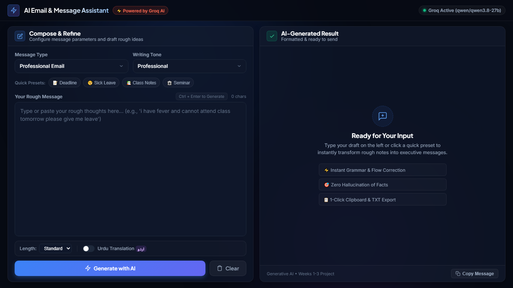

# AI Email & Message Assistant

[](https://www.python.org/)
[](https://flask.palletsprojects.com/)
[](https://console.groq.com/)
[](LICENSE)

A full-stack Generative AI web and console application that transforms rough, informal, or grammatically incomplete text into clear, polite, and professionally structured emails, student messages, leave applications, and formal requests using the **Groq API** and ultra-fast LLMs.

---

## 📌 Project Overview

Writing clear and context-appropriate messages can be challenging for students and professionals. This project bridges that gap by providing an intelligent communication assistant. 

Users can input unedited, conversational, or rough thoughts, select an intended communication type and writing tone, and receive a refined, ready-to-send draft.

### Key Highlights
- **Dual Interface**: Includes both a **Modern Web UI** (Flask + HTML5/CSS3/JavaScript) and an interactive **Command-Line Interface (CLI)**.
- **Zero Page Scrolling**: Modern single-screen dashboard layout that fits standard viewports with internal scrollbars for lengthy drafts.
- **Real LLM Integration**: Directly connected to **Groq API** utilizing high-speed models like `qwen/qwen3.8-27b` with smart automatic fallback.
- **Zero Hallucination Guardrails**: Prompts are strictly engineered to preserve original facts, dates, and details without inventing false information.
- **Productivity Actions**: Instant clipboard copy, `.txt` file export, live regeneration, and quick test presets.
- **Bonus Capabilities**: Optional Urdu translation and customizable output length (Concise, Balanced, Detailed).

---

## 📸 Screenshots

| Modern Viewport Dashboard |
|:---:|
|  |

## 🚀 Features

| Feature | Description |
| :--- | :--- |
| **Message Categories** | Professional Email, Student Message, Leave Application, Formal Request |
| **Writing Tones** | Professional, Polite, Friendly |
| **Subject Extraction** | Automatically identifies or generates appropriate Subject lines for emails and applications |
| **One-Click Presets** | Instant sample buttons to test teacher inquiries, sick leaves, notes requests, and formal permissions |
| **Dual Interaction Modes** | Run via web browser on `http://127.0.0.1:5000` or terminal CLI via `main.py` |
| **Live Actions** | Copy full message, copy subject line, download as `.txt` file, regenerate with fresh LLM call, and clear |
| **Robust Validation** | Handles empty submissions, invalid selections, and missing API keys gracefully with clear alerts |
| **Privacy & Security** | Private API keys are kept safely inside `.env` and never leaked to the client or GitHub |
| **Bonus: Urdu Translation** | Optional toggle to append an accurate Urdu translation (*اردو ترجمہ*) |

---

## 🛠️ Technology Stack

- **Frontend**: HTML5, Modern CSS3 (CSS Grid, Flexbox, Glassmorphism, Responsive Design), Vanilla JavaScript (ES6+, Fetch API).
- **Backend**: Python 3.12+, Flask (RESTful routing, JSON APIs, error management).
- **AI Engine**: Groq Python SDK, `llama-3.3-70b-versatile`.
- **Environment Management**: `python-dotenv`.

---

## 📂 Project Directory Structure

```text
Ai_Email_Msg_Assistant/
│
├── app.py                     # Flask web server & REST API endpoints
├── main.py                    # Terminal / CLI interactive application runner
├── groq_service.py            # Groq API client, model communication & error handling
├── prompts.py                 # Dynamic prompt builder & categories/tones logic
├── requirements.txt           # Python package dependencies
├── .env                       # Local private environment variables (DO NOT COMMIT)
├── .env.example               # Example template for environment configuration
├── .gitignore                 # Specifies intentionally untracked files
├── README.md                  # Comprehensive project documentation
│
├── templates/
│   └── index.html             # Web application interface template
│
└── static/
    ├── style.css              # Modern UI stylesheet & responsive media queries
    └── script.js              # Client-side validation, Fetch API calls & DOM interactions
```

---

## ⚙️ Installation & Setup Guide

### Step 1: Open the Project Directory
Open your terminal (PowerShell, Command Prompt, or VS Code Terminal) in the project folder:
```powershell
cd D:\Ai_Email_Msg_Assistant
```

### Step 2: (Optional) Create and Activate Virtual Environment
```powershell
# Create virtual environment
py -m venv venv

# Activate on Windows
venv\Scripts\activate
```

### Step 3: Install Required Libraries
```powershell
py -m pip install -r requirements.txt
```

### Step 4: Configure Your Groq API Key
1. Sign up or log in to the free [Groq Console](https://console.groq.com/).
2. Navigate to [API Keys](https://console.groq.com/keys) and generate a new key.
3. Open the `.env` file in the project root.
4. Paste your key:
```env
GROQ_API_KEY=gsk_your_actual_groq_api_key_here
GROQ_MODEL=llama-3.3-70b-versatile
```

## 🖥️ Running the Application

### Option A: Web Application (Recommended)
To launch the full web interface:
```powershell
py app.py
```
Open your browser and navigate to:
```text
http://127.0.0.1:5000
```

### Option B: Terminal Console CLI
To run the interactive command-line version:
```powershell
py main.py
```

---

## 🧪 Example Test Cases

| Test Case | Selected Type | Tone | Sample Rough Input | Expected AI Output |
| :--- | :--- | :--- | :--- | :--- |
| **1. Professional Email** | Professional Email | Professional | `i want to ask my teacher about assignment deadline` | Formats a formal email with Subject line, greeting, polite deadline query, and signature placeholder. |
| **2. Leave Application** | Leave Application | Polite | `i have fever and cannot attend class tomorrow please give me leave` | Generates a structured leave application with date, reason, assurance of making up lessons, and polite closing. |
| **3. Student Message** | Student Message | Friendly | `send me yesterday class notes when you are free` | Crafts a warm, approachable peer message requesting lecture notes. |
| **4. Empty Input** | Any | Any | *(Empty text)* | Frontend prevents API call and highlights error: *"Please enter your message."* |
| **5. Missing API Key** | Any | Any | *(No key in .env)* | Backend safely catches error and instructs user to configure `GROQ_API_KEY` in `.env`. |

---

## 🧠 Python Programming Concepts Demonstrated

This project demonstrates core curriculum concepts from Generative AI:

1. **Variables & Primitive Types**: Managing strings, booleans, and numeric thresholds.
2. **Lists & Dictionaries**: 
   - `MESSAGE_TYPES` and `TONES` stored in Python lists for iterative rendering and selection.
   - `CATEGORY_GUIDELINES` and `TONE_GUIDELINES` dictionaries mapping categories to structured instructions.
3. **Control Flow (`if / elif / else`)**:
   - Comprehensive server-side validation of incoming request payloads.
   - Fallback mechanisms for default models and error routing.
4. **Loops (`for` & `while`)**:
   - `while` loops for CLI interactive menus in `main.py`.
   - List iteration for displaying numbered options.
5. **Modular Programming**:
   - Separation of concerns across `prompts.py`, `groq_service.py`, `app.py`, and `main.py`.
6. **Exception Handling (`try / except`)**:
   - Catching `AuthenticationError`, `RateLimitError`, and `APIConnectionError` to safeguard against unexpected crashes.
7. **REST APIs & JSON Handling**:
   - Building endpoints (`POST /generate`, `GET /api/status`) consuming and returning standard JSON.

---

## 🔒 Security Best Practices

- Real API credentials are never hardcoded in source code.
- `.env` is listed in `.gitignore` to prevent leaking private keys to public repositories.
- Error handlers sanitize output to avoid leaking sensitive server environment paths or tokens.

---